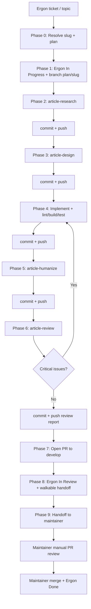

# Pipeline overview

End-to-end flow for [`ship-article`](SKILL.md).

## Actors

| Actor | Responsibility |
|-------|----------------|
| **ship-article agent** | Phases 0–9; open PR; no merge |
| **Maintainer (human)** | Review PR on GitHub; request changes or merge; adjust copy; mark Ergon Done |

## Branches

- **Base:** `develop`
- **Feature:** `plan/<slug>` (e.g. `plan/solar-life-cycle`)
- **Not used:** merge to `main` in this pipeline

## Tracking

Issue tracking is **Ergon** (MCP `user-ergon`), project **Looking Glass**, team **COA**.
Never use Linear for tickets, status, or comments.

## Invoking

| Input | How |
|-------|-----|
| Ergon issue | `@ship-article` skill + issue ID/URL (`COA-123`) |
| Plan path | `@ship-article` + `@plans/concepts/<slug>.md` |
| Topic name | Resolve to plan + Ergon ticket before Phase 1 |

See [`ergon-integration.md`](ergon-integration.md) for MCP details.
